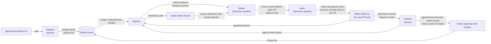

# Autonomous Newsroom: delivery report

| | |
|---|---|
| **Live newsroom** | https://beach-educated-counts-ray.trycloudflare.com *(Cloudflare Quick Tunnel to the author's Mac; see [Hosting](#6-infrastructure-and-hosting) for its limits)* |
| **Repository** | https://github.com/newsroom-ak/autonomous-newsroom (public) |
| **Product** | A news page on "latest AI/ML news": real Google News RSS, model-written one-line summaries and tags, SQLite, "updated X ago", refreshed on a schedule |
| **Who wrote what** | `app/` was written by OpenClaw agents (builder and tester) through GitHub tickets and PRs. `orchestrator/`, `agents/` prompts and configuration snapshots, `scripts/`, `deploy/`, `infra/` and the docs were written by the human with Claude Code assistance (see [section 9](#9-human-involvement-and-disclosures)) |
| **State at hand-over** | Tickets #4–#8 and the live-test bug #16 are merged, and the app runs publicly through a Cloudflare Quick Tunnel from the author's Mac. **Oracle Cloud provisioning failed on host capacity (confirmed).** The intended final design, agents on the Mac and the public app on an AWS `t3.small` in `us-west-2`, is **not deployed**: the AWS account's verification and sign-in are still pending (see [section 6](#6-infrastructure-and-hosting)). |

Every number below comes from `docs/evidence/ledger.jsonl` (the harness's own log), GitHub, or a command run
for this report. Where something is an estimate or an interpretation, it says so.

---

## 1. What was asked, and what was delivered

| Requirement from the brief | Status | Evidence |
|---|---|---|
| OpenClaw **and** Hermes, both used, with orchestrator, builder, reviewer, tester | ✅ | [Roster](#2-agent-roster) |
| Tickets flow through something inspectable; review and test can send work back | ✅ | GitHub issues #4–#8, #16; PRs #9, #11, #13, #14, #15, #17; [rejections](#5-what-broke-and-how-it-was-handled) |
| Agents write the code; git history shows agent-authored commits | ✅ for `app/` | 30 agent commits on `main` (17 builder, 13 tester); [section 3](#3-what-each-agent-actually-did) |
| Free stack: free VM provisioned with Terraform, free models | ⚠️ partial | Oracle Terraform exists (`infra/`) but **no VM was ever created** (confirmed host-capacity failure, [section 6](#6-infrastructure-and-hosting)). AWS plan B is drafted but **not deployed** (account verification pending). Models: Ollama Cloud free plan only. |
| Public URL that loads and does the core thing | ✅ with limits | Quick Tunnel; URL changes if the tunnel restarts; the Mac must stay on |
| Page: ~10 articles, one-line summary, topic tag, source link, "updated X ago" | ✅ | Verified live: 10 articles, none empty, model-written summaries |
| Scheduled refresh, stored in a database | ✅ | In-app scheduler (startup + every 180 min), SQLite. **Verified live:** the second refresh fired on its own exactly 180 minutes after the first ([section 8](#8-quality-gates-in-practice)) |
| Summarize once, fall back to a second free model on 402/429 | ✅ | Verified live (HTTP 402 from `kimi-k3` triggers the fallback); title fallback is marked as such |
| `agents/` with each agent's config, prompts and skills (secrets removed) | ✅ | Prompts, `agents/team.json`, and sanitized Hermes/OpenClaw snapshots with provenance in `agents/SNAPSHOT.md` |
| Token and model report | ✅ | [Section 4](#4-token-and-model-report), including a cross-check against Hermes's own usage records |
| Trace excerpts, reproduce instructions | ✅ | [Section 7](#7-trace-excerpts), [section 10](#10-reproduce) |
| Reproduce with `terraform apply` + one install script | ❌ | No VM was created, so nothing was reproduced from a `terraform apply`. The Mac-based procedure is in [section 10](#10-reproduce); an AWS Terraform proposal exists but is unapplied. |

---

## 2. Agent roster

| Agent | Runtime | Role | Model actually used | Tools |
|---|---|---|---|---|
| **dispatch** | Hermes, profile `dispatch` | Orchestrator: turns the brief into tickets, assigns each ticket to the builder, writes rework instructions after a rejection | `ollama-cloud/nemotron-3-ultra` | Hermes `todo` toolset only (verified live: the only tool that ran was `todo_list`; no shell, files or web) |
| **builder** | OpenClaw, agent `builder` | Implements one ticket per PR; edits only `app/` | `ollama-cloud/gpt-oss:120b` | OpenClaw `coding` profile inside a Docker sandbox: network `none`, read-only root, all capabilities dropped, non-root, only its own workspace mounted read-write. `exec` is denied (verified live: `exec denied: host=sandbox security=deny`). |
| **tester** | OpenClaw, agent `tester` | Writes independent acceptance tests from the ticket | Configured `ollama-cloud/gpt-oss:20b`; used for #4's first run. From #4's recheck onward `gpt-oss:120b` was selected per run (`--model`) because the 20b tests were too weak. | Same sandbox as the builder |
| **reviewer** | Hermes, profile `reviewer` | Reads the PR diff, committed tests and pytest output against the ticket; approves or requests changes | `ollama-cloud/nemotron-3-super` | `todo` only |
| *orchestrator harness* | Python (`orchestrator/`), **not an agent** | Plumbing only: git checkouts, GitHub calls with each agent's own token, the offline test container, the token ledger | none | Deterministic. It never chooses a ticket, writes product code or decides a verdict. |
| *human* | `Ankita2525` | Product owner; reviews and merges | – | Only account that can approve or bypass the ruleset |

Configuration, prompts and "skills" for every agent are in `agents/` (see `agents/SNAPSHOT.md`); no custom skills were written. Hermes `delegate_task` and the OpenRouter per-agent keys were not used.

Local Ollama models (`qwen2.5:7b`, `llama3.1:8b`) were tried in early rehearsals, before any real ticket, and
rejected: they could not produce valid plans, assignments or tool calls. Fallback chains still list more Ollama
Cloud models, OpenRouter and local Ollama, but **no OpenRouter key was ever configured and no reply from a non-cloud model was ever accepted**: the harness refuses them, and the ledger
shows only `ollama-cloud/*` models. Only six models on the Ollama Cloud free plan answered (probed with 1-token
requests); `kimi-*`, `glm-*`, `minimax-*`, `deepseek-*` and `mistral-large-*` returned HTTP 402.

**Why this split.**
- *Runtimes by trust level.* Agents that execute or write code from model output (builder, tester) run on
  OpenClaw in a no-network sandbox. Agents that only read and judge (dispatch, reviewer) run on Hermes with no
  system tools.
- *Tester separate from reviewer.* The reviewer reads; the tester runs the code. In this project the tester's
  tests were the gate that actually blocked bad work (see [section 5](#5-what-broke-and-how-it-was-handled)).
- *One ticket at a time.* The Ollama Cloud free plan allows one concurrent request, so parallel builders would
  only queue.
- *Cheaper model for routine work, stronger for judgement* was the plan; in practice the free plan restricted
  the choice and the cheap tester model (`gpt-oss:20b`) was not good enough, so the larger one did most work.

---

## 3. What each agent actually did

### Workflow



Each arrow is a GitHub label change plus a comment headed `**[agent · runtime · model]**` with a hidden
machine-readable event; the same event is appended to the ledger with token usage. Merge gate on `main`:
pull request only, `agent/review` and `agent/test` required, one approval from someone other than the last
pusher (only the human account), no Actions.

### Tickets

Dispatch created #4–#8 from the brief in one planning call (5,288 tokens). Ticket #16 was reported by the human
from live testing and filed through the harness. Counts below are from the ledger.

| Ticket | PR | Builder runs | Tester model runs | Deterministic re-runs (no model) | Reviews | Outcome |
|---|---|---:|---:|---:|---|---|
| #4 RSS ingestion, SQLite | #9 | 3 | 5 | 1 | 4 approvals | merged after a human-requested recheck found a real defect |
| #5 Summarization + fallback | #11 | 4 (1 human-authorized extra) | 1 (+1 aborted) | 4 | 1 approval | merged |
| #6 JSON API | #13 | 1 | 2 | 0 | 1 approval | merged |
| #7 Public page | #14 | 4 (1 human-authorized extra) | 3 | 5 | 1 approval | merged |
| #8 Scheduler | #15 | 3 | 2 | 3 | 1 invalid reply, **1 rejection**, 1 approval | merged |
| #16 Live-test bug | #17 | 2 | 1 (+2 aborted) | 3 | 1 approval | merged; its final test fix was **human-assisted** |

Commits on `main`: 17 by `builder (OpenClaw agent)`, 13 by `tester (OpenClaw agent)` (tester commits are
authored by the tester but committed by `newsroom-orchestrator (harness)`, see below), 23 non-merge commits by
the human. Builder commits carry trailers (`Ticket`, `Agent`, `Runtime`, `Model`, `Attempt`, `Session`) that
match the OpenClaw session.

**How a tester commit is made.** The tester's token is read-only for repository contents (so a gatekeeper cannot
change code it judges). The harness therefore copies the tester's file verbatim into `app/tests/acceptance/`
and pushes it with the *builder's* token; the commit says so, and all four tokens belong to one machine account.
Builder imports cannot touch that directory.

---

## 4. Token and model report

**Source:** `docs/evidence/ledger.jsonl`: 62 runs with usage (99 events in total). Numbers are what each
runtime *reported*: OpenClaw `agentMeta.usage.total`, Hermes `--usage-file` (including its automatic title call).

### By phase (all tickets)

| Phase | Runs | Model requests | Reported tokens | Share |
|---|---:|---:|---:|---:|
| Planning (dispatch plan + assignments) | 17 | 34 | 80,419 | 0.5% |
| Coding (first builder attempt per ticket) | 6 | 162 | 2,345,612 | 15.4% |
| Testing (first tester run per ticket) | 7 | 112 | 1,567,928 | 10.3% |
| Review (first review per ticket) | 2 | 4 | 25,646 | 0.2% |
| **Retries: coding** (later builder attempts) | 11 | 139 | 1,723,542 | 11.3% |
| **Retries: testing** (re-runs, focused corrections) | 7 | 84 | 996,858 | 6.5% |
| **Retries: review** | 8 | 16 | 125,561 | 0.8% |
| **Aborted tester runs** (hit the wall-clock deadline, produced nothing usable) | 3 | 145 | 8,394,471 | **55.0%** |
| Invalid reviewer reply (malformed JSON, rejected by the harness) | 1 | 2 | 13,909 | 0.1% |
| **Total reported** | | | **15,273,946** | |

Runs without a model call (deterministic test runs, publishing tests, escalations) cost 0 and are not counted.

### By agent, model and ticket

| Agent | Model | Reported tokens |
|---|---|---:|
| tester | `gpt-oss:120b` (10,471,065) + `gpt-oss:20b` (488,192) | 10,959,257 |
| builder | `gpt-oss:120b` | 4,069,154 |
| reviewer | `nemotron-3-super` | 165,116 |
| dispatch | `nemotron-3-ultra` | 80,419 |

| Ticket | #4 | #5 | #6 | #7 | #8 | #16 | planning |
|---|---:|---:|---:|---:|---:|---:|---:|
| Reported tokens | 1,510,105 | 1,566,417 | 786,019 | 1,089,886 | 1,180,241 | 9,135,990 | 5,288 |

Excluding the three aborted runs, the whole project used **6,879,475** reported tokens.

### Where the tokens went, in plain words

1. **More than half (55%) was three aborted tester runs.** OpenClaw has no per-run limit on model requests,
   only a wall-clock deadline. Two runs on ticket #16 made 29 and 101 requests before the deadline and produced
   no file changes; they alone account for 8.2M reported tokens. Lesson: a hard request cap is needed before
   giving an agent an open-ended edit task (see [improvements](#12-what-i-would-change)).
2. **The builder and tester dominate the useful spend.** Review and planning together are under 2%.
3. **Retries cost 18.6% of the total (41% of the non-aborted spend).** Most were caught by the tester's tests,
   not the reviewer (see section 5).

### What these totals do and do not mean (please read)

- **They are not provider-billed tokens.** Ollama Cloud's free plan reports no cost and we did not reconcile
  against its usage page.
- **OpenClaw's total is much larger than input + output.** For example the first builder run on #4 reported
  8,222 input + 9,126 output but a total of 257,476. Our interpretation (not confirmed by OpenClaw's
  documentation) is that the total counts the full prompt (system prompt, tool schemas, history; about 7–11K
  tokens) again on every model request, so it grows with the number of requests. Treat OpenClaw totals as a
  consistent *relative* measure of work, not a bill. Hermes totals are close to input + output plus its automatic title call (cross-check below).
- **The aborted runs' numbers are partial.** They are what the runtime returned when the deadline hit.
- **One run has no usage record.** Ticket #7's builder attempt 3 hit its deadline and OpenClaw returned no
  usage; the ledger records it as 0 although it did consume tokens (unknown).
- `openclaw gateway usage-cost` returned zeros for this profile, so **OpenClaw numbers have no second source**; only the Hermes numbers could be cross-checked (next subsection).
- **Turn budgets were advisory.** "Max turns" was a prompt hint plus a wall-clock deadline; runs routinely
  exceeded it (for example 27 requests against a budget of 12).

### Cross-check of the Hermes numbers against Hermes's own records

The brief points to `hermes insights` for token tracking. We compared it, and Hermes's session exports, with
the ledger. Hermes sessions were matched to ledger runs by start time (every pair within 8.5 s).

| | Ledger runs | Hermes sessions | Paired | Ledger tokens | Paired sessions' in+out | `hermes insights` total |
|---|---:|---:|---:|---:|---:|---:|
| reviewer | 11 | 11 | 11 | 165,116 | 152,526 | 165,404 |
| dispatch | 17 | 22 | 17 | 80,419 | 71,997 | 100,713 |

What explains the differences (measured, not guessed):

1. **Ledger vs session in+out (+12,590 reviewer, +8,422 dispatch):** the ledger records the Hermes usage
   report's `total_including_auxiliary`, which adds the automatic title-generation calls that the session
   tables leave out.
2. **Reviewer, `insights` vs ledger (+288, 0.17%):** `insights` also counts those auxiliary sessions, some run
   on other models (`gpt-oss:120b` 1,424; `llama3.1:8b` 501 tokens). Not itemized further.
3. **Dispatch, five sessions that are in Hermes but not in the ledger (19,007 tokens in+out, about 0.12% of the
   15.27M total):** four on the local `llama3.1:8b` (16,684 tokens) and one on `nemotron-3-ultra` (2,323 tokens,
   a connectivity check). All five started before the first real planning call (about 15:19 local time on
   Oct 11) and were verification and rehearsal sessions run by the engineer outside the orchestrator, so they
   never produced product work and were never ledgered.
4. **Dispatch, `insights` 100,713 vs ledger 80,419 plus the unledgered 19,007 = 99,426:** a residual of 1,287
   tokens (1.3%) that we did not itemize; it is probably auxiliary calls for those extra sessions, but that is an
   inference.

We did not add any estimate for the missing OpenClaw usage record (ticket #7, attempt 3) or for the unledgered
sessions to the totals above; the report states only what the runtimes reported.

---

## 5. What broke, and how it was handled

The system caught real problems; most were caught by tests the tester wrote, one by the reviewer, several by
the human reading output. None of the product code below was fixed by a human.

| # | What broke | How it was caught | Resolution |
|---|---|---|---|
| 1 | **#4: the reviewer approved a PR that missed an acceptance criterion** (it said the tests mocked HTTP; they replaced the fetch function) and the tester's first tests were weak | Human read the diff | Human-requested recheck; the tester (stronger model) added real RSS-parsing and failure tests |
| 2 | **#4: the refresh function called `sys.exit(1)` on errors**, which would have killed the in-app scheduler built later | Tester's test failed with `SystemExit` | Builder attempt 2 fixed connection errors only; the tester's HTTP 500 test caught that; attempt 3 fixed it |
| 3 | **#5: dispatch invented instructions** ("local fallback model", wrong file path) because it only saw ticket titles | Human read the handoff | Harness change: dispatch now gets each candidate's full text |
| 4 | **#5: a harness prompt change misdirected the tester's output file**; the harness then reported "no tests" and escalated | Human read the escalation | Prompt fixed; the tester's file was published unchanged; no model rerun |
| 5 | **#5: settings read at import time; wrong test expectations** (fallback semantics) | Tester's tests | 3 attempts, then a human-authorized extra attempt limited to two faulty builder tests (the reason is recorded on the issue) |
| 6 | **#6: the tester's clock stub broke the code under test** | Failing test | Focused tester correction |
| 7 | **#7: builder attempts 1–2 claimed to edit `api.py` but never did** (false commit messages); then the template was wrapped in ``, so the page rendered Jinja source | Smoke run (broken import), then tests | Tool-call failures are now recorded; a human-authorized scoped attempt removed the wrapper |
| 8 | **#7: the tester's file contained literal `\n` sequences**, so pytest could not parse it | pytest `SyntaxError` | The harness converted only those sequences (lossless, disclosed in the commit); later three wrong expectations corrected by focused tester runs |
| 9 | **#8: tests needed `pytest-asyncio` (not installed); no per-run error handling; deprecated `on_event`** | Smoke run and tests | Builder attempts 2–3 |
| 10 | **#8: a genuine reviewer rejection** ("use lifespan, not `on_event`") after one malformed reviewer reply that the harness refused | Reviewer | Scoped builder fix, approved on the same ticket |
| 11 | **Live test (#16): Google News returns HTTP 302 and the app did not follow it, so the merged app could not ingest anything; 4 of 10 model summaries were empty** (the reasoning model spent its token budget thinking) | Human-supervised run against the real feed and Ollama Cloud. All offline tests had passed. | Ticket #16 through the normal workflow; the tester's tests then found two *new* defects in the builder's fix (`URL(base=…)` is not valid httpx; a path returned `None`); fixed on attempt 2 |
| 12 | **#16: two tester runs aborted at the deadline (8.2M reported tokens)** | Harness | See the token section; the tester's finished partial edit was recovered; the rest (test doubles) was fixed by the human, disclosed as human-assisted maintenance |

**The single most instructive failure** is #11: every offline test, review and approval passed, and the merged
application still could not fetch its only data source. The live run was the real test.

**The reviewer produced one genuine rejection in six tickets** and approved flawed commits on #4 three times.
Its summaries are generic. The effective quality gate was the tester's executable tests plus deterministic
re-runs; the reviewer is a weaker second gate (see improvements).

---

## 6. Infrastructure and hosting

### Oracle Cloud Always Free: confirmed capacity failure

`infra/` holds the Terraform for one `VM.Standard.A1.Flex` instance. Its five network resources were created
(they cost nothing); the instance never was. What was checked, read-only, against Oracle's own records:

- **Two launch attempts, both failed.** Oracle's audit log shows `LaunchInstance` at 18:31:29Z and 18:34:27Z on
  Oct 11, each HTTP 500 `InternalError`. Oracle's documentation describes that error as "Out of host capacity".
  The Terraform console text was not retained, so the wording itself is documented rather than recorded.
- **Not a quota or configuration problem:** the tenancy limits exceed the request with nothing used; the shapes
  are offered; the image was found; no fault domain is pinned. The home region `us-sanjose-1` has **a single
  availability domain** (with 3 fault domains), so the brief's "try another availability domain" is not
  possible here.
- **Oracle's capacity-report API** (a pre-check that provisions nothing) returned `OUT_OF_HOST_CAPACITY` for
  `A1.Flex` at 1 OCPU / 6 GB, `A1.Flex` at 2 OCPU / 12 GB, and `E2.1.Micro`. No instance or capacity reservation
  exists, and the Terraform state was not changed.
- **The brief's playbook:** other AD (not available), no fault-domain pin (already so), 1 OCPU / 6 GB (checked
  through the report, never launched), retry later (not done over a sustained period: less than a day had
  passed when plan B was chosen, so the brief's "still blocked after a day" condition was **not** strictly
  met; this was a deliberate decision, not a finding that Oracle stays full).

### Architecture decision and AWS (plan B): pending, not deployed

The agent environment (Hermes, OpenClaw, the orchestrator and every agent credential) stays on the author's
Mac. Only the lightweight public application (FastAPI + SQLite + Caddy) is meant to run on a cloud VM:
**AWS EC2 `t3.small` in `us-west-2`**, provisioned with Terraform. The trade-off is that the VM does not
reproduce the agent environment; it hosts only what the public needs, and nothing on it can reach agent tokens
or sandboxes.

- **Why `t3.small`, not the brief's `m7i-flex.large`:** the app uses about 60 MB of memory; `m7i-flex.large`
  costs $0.0958/hr (about $70/month) so the $100 Free Plan credit would last about 40 days, after which the
  account closes, whereas `t3.small` lasts about 149 days. Both are Free-Plan eligible per AWS's documentation.
- **What exists:** a Terraform proposal (one instance in the default VPC, one security group, one key pair, one
  Elastic IP, Caddy for HTTPS, systemd units, no IAM role, no secrets in Terraform) drafted and validated
  offline, with its bootstrap rehearsed in a clean Ubuntu 24.04 container. It lives on a separate branch
  (`infra/aws-plan-b`) and is **not part of this repository snapshot or this PR**. Nothing was applied.
- **Where it stands:** the AWS Free Plan account is created and active, but **no AWS resource and no access key
  exists.** In the new AWS "Team" experience an IAM user cannot be given a console password; `aws login` and
  `aws login --remote` did not complete (the browser showed "Something went wrong" instead of the session
  picker), and AWS CloudShell reports "Your account verification is in progress. This may take up to two days
  for new accounts." The author stopped authentication attempts until verification completes.
- **Do not read the AWS work as a deployment.** The only public deployment is the Quick Tunnel below.

### Current public deployment: Cloudflare Quick Tunnel from the author's Mac

- `deploy/run-newsroom.sh` serves the merged app from an immutable `git archive` in a hardened container bound
  to `127.0.0.1:8000` and points `cloudflared` at that single port (the brief's documented emergency fallback).
- **Verified running code:** byte-identical to `app/` on `main` at `f3349a0` (`app/` is unchanged on `main`
  since). The container has run continuously since 2026-10-12 02:31Z.
- **Limitations:** the `trycloudflare.com` URL changes whenever the tunnel restarts; the Mac must stay awake and
  online; Quick Tunnels have no uptime guarantee.
- **Exposure checks before the URL was shared** (local and through the tunnel): loopback-only port binding;
  only `/`, `/api/articles` and FastAPI's auto-generated `/docs`, `/redoc`, `/openapi.json` are served; writes
  return 405; probe and traversal paths return 404; exact-match scans of every response found none of the
  env values, the four GitHub tokens or the OpenClaw gateway token; requests with `Host:` headers for the
  OpenClaw gateway, Ollama and the Docker port return 403.
- **Agent runtimes:** OpenClaw's gateway is loopback-only with token authentication; Hermes has no listener.
  Neither is reachable through the tunnel.

---

## 7. Trace excerpts

Real lines, trimmed. Full log: `docs/evidence/ledger.jsonl`.

**A handoff** (GitHub comment on issue #16, written by dispatch through its own token):
```
**[dispatch · hermes · ollama-cloud/nemotron-3-ultra]** **dispatch → builder**: assigned #16 (attempt 1/3).
```
```json
{"ts": "2026-10-11T15:21:33-0700", "event": "assign", "agent": "dispatch", "runtime": "hermes", "ticket": 4, "attempt": 1, "outcome": "assigned:builder", "model": "nemotron-3-ultra", "tokens": 3188, "calls": 2}
```

**A review rejection** (PR #15, reviewer, `agent/review=failure` posted on commit `fac912d`):
```
**[reviewer · hermes · ollama-cloud/nemotron-3-super]** **reviewer → dispatch**: CHANGES REQUESTED on `fac912d` (attempt 2).
The implementation uses deprecated @app.on_event handlers instead of FastAPI's lifespan as clarified in the ticket.
- `app/newsroom/main.py`: Uses deprecated @app.on_event("startup") and @app.on_event("shutdown") ...
```
```json
{"ts": "2026-10-11T18:52:00-0700", "event": "review", "agent": "reviewer", "ticket": 8, "attempt": 2, "outcome": "request_changes", "model": "nemotron-3-super", "tokens": 13729, "calls": 2}
```

**A test failure that caught a real defect** (PR #9, tester, on the builder's first repair, commit `3f96ac7`):
```
**[tester · openclaw · ollama-cloud/gpt-oss:120b]** **tester → dispatch**: FAIL on `3f96ac7` (pytest exit 1, ...)
newsroom/refresh.py:84: in _run_refresh
E   SystemExit: 1
```

**A retry and the builder's commit record** (`git log`):
```
9200d75 builder (OpenClaw agent)   Ticket: #16  Agent: builder  Runtime: OpenClaw
                                   Model: ollama-cloud/gpt-oss:120b  Attempt: 2  Session: ticket-16-build-2
```

**An escalation that was the harness's fault, kept as it happened** (issue #5): the harness reported
`dispatch → @Ankita2525: escalated. tester failed to produce acceptance tests` when the tester had in fact
written its tests to a path the harness did not expect.

**Human-authorized exceptions** are ledger events too:
```json
{"ts": "2026-10-11T17:44:29-0700", "event": "exception-authorized", "agent": "human", "ticket": 5, "attempt": 4, "outcome": "extra-attempt"}
```

---

## 8. Quality gates in practice

| Gate | Result |
|---|---|
| Direct push to `main` | Blocked by the ruleset (HTTP 422), verified (`docs/traces/permission-test.md`) |
| Builder cannot post `agent/review` / `agent/test` | Verified: HTTP 403 with the builder token |
| Machine account cannot approve its own PR | Verified (PR #1) |
| Six agent-authored PRs | Each merged with `agent/review` **and** `agent/test` = success on the merged head commit, approval by the human |
| Tests run offline | Builder and tester tests ran in a container with `--network none`, read-only root, no capabilities, no tokens |

### Independent product verification (read-only checks, 2026-10-11 evening PDT)

| Check | Result |
|---|---|
| Product tests on `main`, offline container | **38 passed** (builder and tester tests from tickets #4-#8 and #16) |
| Harness tests | **37 passed** |
| Secrets and forbidden files tracked on `main` | none found (token patterns, key blocks, cloud IDs; no state, tfvars, env, token, ledger or database files) |
| Live site | HTTP 200; 10 articles in the API; the page shows real headlines, model-written summaries, tags, source links and "updated N minutes ago" |
| **Scheduled refresh, live** | `refresh_runs` has two rows. Run 1 started at startup (02:31:28Z, 100 fetched, 100 new). **Run 2 started on its own at 05:32:52Z, exactly 180 minutes after run 1 finished** (02:32:52Z): 100 fetched, **6 new** (94 duplicates skipped by the unique source URL). |
| Summaries, live | 105 articles stored; 24 summarized (the per-refresh cap of 12 applied twice): 23 `model` (`gpt-oss:20b`), 1 title `fallback`; none empty |

---

## 9. Human involvement and disclosures

**Administrative bypass merges.** PRs #2, #3, #10, #12 and #18 are human-written, have no `agent/*` statuses on
their head commits (checked on GitHub), and were merged by `Ankita2525` through the ruleset's pull-request
bypass, the only way to merge a PR with no `agent/*` statuses. PRs #19 and #20 are in the same position and
need the same approval. All six agent-authored PRs (#9, #11, #13, #14, #15, #17) merged
normally with both statuses green. Branch protection was never disabled.

**Written by the human with Claude Code (AI assistance), not by the agents:** `orchestrator/` (the harness and
its tests), `agents/` prompts and configuration, `scripts/`, `docker/test-runner/`, `deploy/`, `infra/`,
`docs/`, the agent configuration snapshots (generated by `scripts/snapshot_agent_configs.py`), and this report.
The product brief (`agents/shared/brief.md`) is human-written.

**Human actions on agent work (all recorded on the GitHub tickets/PRs):**
- Added acceptance criteria and clarifications to #5, #6, #7, #8 before or after assignment (labelled as the
  product owner's).
- Requested the quality recheck on #4 after the first approvals.
- **Human-authorized exceptional builder attempts** beyond the 3-attempt limit on #5 and #7, scoped to named
  files with a task that replaced the ticket text. On #8 and #16 a scoped repair task was also used for one
  attempt; on #16 dispatch's own suggested approach differed from the human's task.
- **#7:** converted the tester's `\n` sequences mechanically (lossless, disclosed in the commit).
- **#16:** wrote the bug report text (filed through the harness with a disclosure line), recovered the tester's
  unpublished partial edit verbatim, and wrote **commit `2f9d2b2`: human-assisted corrections to faulty test
  doubles in `test_ticket_4.py` and `test_ticket_16.py`**. It is authored and committed by the human, pushed
  with the machine account's token so the human could still approve. **That commit is not agent output.** No
  production code was changed by a human.

**Credential boundary.** Four fine-grained tokens exist (dispatch, builder, reviewer, tester) but they belong to
one machine account, so GitHub cannot tell them apart in the UI and any token with commit-status write could
post either gate. The harness posts each status with the right agent's token; this separation is by
convention, not enforced by GitHub.

---

## 10. Reproduce

This is a Mac-based procedure; there is no one-command Linux install because no VM was created (Oracle: no capacity; AWS: pending verification).

1. **Prerequisites:** Docker Desktop, Node 24.16+ or 26, `uv`, `gh`, Python 3.13+, `terraform` (for `infra/`
   only), `brew install cloudflared`, a free Ollama Cloud API key, and four fine-grained GitHub tokens on a
   machine account as described in `docs/agent-identity.md`.
2. **Runtimes:** OpenClaw `2026.10.1` (`npm install openclaw@2026.10.1` in `~/agents/openclaw-runtime`, then
   `openclaw --profile confer-newsroom onboard` to create the gateway token) and Hermes
   (`install.sh` from `NousResearch/hermes-agent`).
3. **Secrets (outside the repo):** `~/.config/newsroom/env` (`OLLAMA_API_KEY=...`, mode 600) and
   `~/.config/newsroom/tokens/{dispatch,builder,reviewer,tester}` (mode 600).
4. **Agents:** `python3 scripts/setup_agents.py` (creates the Hermes profiles and OpenClaw agents, refuses to
   run if the sandbox baseline has drifted, builds the offline test image), then `scripts/start-gateway.sh`
   in its own terminal.
5. **Run the team:** `python3 -m orchestrator plan`, then repeat `python3 -m orchestrator step`
   (assign, build, test, review). Token report: `python3 -m orchestrator report`.
6. **Deploy:** `deploy/run-newsroom.sh origin/main` (waits up to 5 minutes for the first refresh, then opens the
   tunnel and prints the URL).
7. **Harness tests:** `uv run --python 3.14 --with pytest python -m pytest -q orchestrator/tests`.
   **Agent configuration snapshots:** `python3 scripts/snapshot_agent_configs.py` regenerates them (sanitized).
8. **Oracle (not completed):** `infra/` with `terraform.tfvars` from the example; expect the capacity error
   until Oracle has capacity in `us-sanjose-1` (check first with Oracle's compute capacity-report API).
9. **AWS (proposed, not applied):** see the drafted Terraform on the `infra/aws-plan-b` branch; it needs an
   AWS CLI session with EC2 rights, which was not available at hand-over.

---

## 11. Known issues and limitations

- **Slow first start.** The scheduler awaits its first refresh before the server begins answering (about 70 s
  observed), so the site is unreachable for that long after any restart. Tests could not see this.
- **`/docs`, `/redoc` and `/openapi.json` are public.** They describe the two read-only routes; no secrets and
  no write endpoints.
- **Topic tags are weak:** the first word of the summary, as the ticket specified ("find", "one", "ai").
- **800 completion tokens is marginal for reasoning models**; some articles fall back to the marked title.
- **Hosting:** the URL changes if the tunnel restarts; the Mac must stay awake; no uptime guarantee.
- **No Terraform-created VM exists** (Oracle: no capacity; AWS: verification pending), the weakest part of the
  infrastructure-as-code criterion.
- **Token ledger gaps:** one OpenClaw run has no usage record, five Hermes verification sessions (19,007 tokens)
  are not in the ledger, and OpenClaw totals have no independent source (section 4).
- **Builder's own `test_scheduler.py`** starts and stops the scheduler in separate event loops, so it checks less
  than it looks like; the tester's acceptance tests cover the real behaviour.
- **No request cap on agent runs** and advisory turn budgets (see section 4).
- **Single machine account** for all four agents; separation is by token scope and harness convention.
- **The first live run found real defects that offline tests could not.** Further live-only defects may remain.

---

## 12. What I would change

1. **Put a hard request limit in front of the model endpoint** (a small counting proxy) so no agent run can
   spend millions of tokens; make turn budgets real.
2. **Shrink OpenClaw's per-request prompt** (a minimal tool profile and short workspace files) to cut the
   dominant cost.
3. **Give the reviewer a stronger model and a harder job**: it approved flawed commits; the fix started here
   (it now sees the committed tests and pytest output) but it still produced one rejection in six tickets.
4. **Run a live smoke test as part of the workflow** (real feed, one real model call) so defects like the Google
   News redirect are caught before merge.
5. **Move the first refresh into a background task** so the server answers immediately, and disable `/docs`.
6. **A real VM:** keep retrying Oracle, or use the brief's AWS plan B, with a named Cloudflare tunnel or Caddy
   instead of a Quick Tunnel.
7. **Per-agent identities** (one OpenRouter key per agent, Langfuse for traces) to get independent usage numbers
   and GitHub-enforced separation.
8. **Smaller tickets** and a rule that a builder may not claim an edit it did not make (the tool-failure
   recording is a first step).
