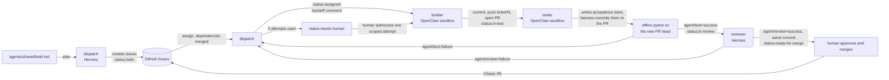

# Autonomous Newsroom: delivery report

| | |
|---|---|
| **Live newsroom** | https://3-13-197-253.sslip.io *(AWS EC2 `t3.small`, Ohio, Terraform-provisioned, HTTPS; running `b62706a`, see [Hosting](#6-infrastructure-and-hosting)). The earlier Cloudflare Quick Tunnel has been retired and its URL no longer works.* |
| **Repository** | https://github.com/newsroom-ak/autonomous-newsroom (public) |
| **Product** | A news page on "latest AI/ML news": real Google News RSS, model-written one-line summaries and tags, SQLite, "updated X ago", refreshed on a schedule |
| **Who wrote what** | `app/` was written by OpenClaw agents (builder and tester) through GitHub tickets and PRs. `orchestrator/`, `agents/` prompts and configuration snapshots, `scripts/`, `deploy/`, `infra/` and the docs were written by the human with Claude Code assistance (see [section 9](#9-human-involvement-and-disclosures)) |
| **State at hand-over** | Tickets #4–#8, the live-test bug #16, and two later tickets, **#25** (structured, validated summaries and tags) and **#27** (a prompt correction), are merged. The app runs publicly on an **AWS EC2 `t3.small` in `us-east-2` (Ohio), provisioned with Terraform**, at https://3-13-197-253.sslip.io, currently on commit `b62706a`. Oracle provisioning failed on confirmed host capacity. The agents (Hermes, OpenClaw, orchestrator) stay on the Mac by design (see [section 6](#6-infrastructure-and-hosting)). Three kinds of work are kept apart throughout: **agent-authored implementation**, **human-assisted tests**, and **human-assisted production maintenance** ([section 9](#9-human-involvement-and-disclosures)). |

Every number below comes from `docs/evidence/ledger.jsonl` (the harness's own log), GitHub, or a command run
for this report. Where something is an estimate or an interpretation, it says so.

---

## 1. What was asked, and what was delivered

| Requirement from the brief | Status | Evidence |
|---|---|---|
| OpenClaw **and** Hermes, both used, with orchestrator, builder, reviewer, tester | ✅ | [Roster](#2-agent-roster) |
| Tickets flow through something inspectable; review and test can send work back | ✅ | GitHub issues #4–#8, #16, #25, #27; PRs #9, #11, #13, #14, #15, #17, #26, #28; [rejections](#5-what-broke-and-how-it-was-handled) |
| Agents write the code; git history shows agent-authored commits | ✅ for `app/` | 39 agent commits on `main` (21 builder, 18 tester); [section 3](#3-what-each-agent-actually-did). Three test-only commits inside agent PRs are human-assisted and labelled (section 9). |
| Free stack: free VM provisioned with Terraform, free models | ✅ AWS / ❌ Oracle | A Terraform-provisioned VM exists on **AWS** (Free Plan, `t3.small`, Ohio; [section 6](#6-infrastructure-and-hosting)). Oracle Always Free **never created a VM** (confirmed host-capacity failure). The brief's `m7i-flex.large` was replaced by `t3.small` to stretch credit. Models: Ollama Cloud free plan only. |
| Public URL that loads and does the core thing | ✅ | **https://3-13-197-253.sslip.io** (AWS EC2 `t3.small`, Ohio, Terraform-provisioned, HTTPS; verified 2026-10-12 including a reboot test; updated to `b62706a` on 2026-10-15). The Cloudflare Quick Tunnel fallback has been retired. |
| Page: ~10 articles, one-line summary, topic tag, source link, "updated X ago" | ✅ | Verified live: 10 articles, none empty, model-written summaries |
| Scheduled refresh, stored in a database | ✅ | In-app scheduler (startup + every 180 min), SQLite. **Verified on AWS** (read-only check of the VM's `refresh_runs`, 2026-10-15): 32 runs, and each recent timer-driven run (e.g. runs 27–31) started exactly 180 minutes after the previous one finished. Also verified earlier on the Mac deployment ([section 8](#8-quality-gates-in-practice)). |
| Summarize once, fall back to a second free model on 402/429 | ✅ | Verified live (HTTP 402 from `kimi-k3` triggers the fallback); title fallback is marked as such |
| `agents/` with each agent's config, prompts and skills (secrets removed) | ✅ | Prompts, `agents/team.json`, and sanitized Hermes/OpenClaw snapshots with provenance in `agents/SNAPSHOT.md` |
| Token and model report | ✅ | [Section 4](#4-token-and-model-report), including a cross-check against Hermes's own usage records |
| Trace excerpts, reproduce instructions | ✅ | [Section 7](#7-trace-excerpts), [section 10](#10-reproduce) |
| Reproduce with `terraform apply` + one install script | ✅ app / ⚠️ agents | `infra/aws/` (`terraform apply` + cloud-init) reproduced the public app on a fresh VM; a fresh plan afterwards showed no changes. The model key is installed over SSH afterwards (a manual step by design). The agent environment is **not** reproduced on the VM; it is a Mac-based procedure ([section 10](#10-reproduce)).

---

## 2. Agent roster

| Agent | Runtime | Role | Model actually used | Tools |
|---|---|---|---|---|
| **dispatch** | Hermes, profile `dispatch` | Orchestrator: turns the brief into tickets, assigns each ticket to the builder, writes rework instructions after a rejection | `ollama-cloud/nemotron-3-ultra` | Hermes `todo` toolset only (verified live: the only tool that ran was `todo_list`; no shell, files or web) |
| **builder** | OpenClaw, agent `builder` | Implements one ticket per PR; edits only `app/` | `ollama-cloud/gpt-oss:120b` | OpenClaw `coding` profile inside a Docker sandbox: network `none`, read-only root, all capabilities dropped, non-root, only its own workspace mounted read-write. `exec` is denied (verified live: `exec denied: host=sandbox security=deny`). |
| **tester** | OpenClaw, agent `tester` | Writes independent acceptance tests from the ticket | Configured `ollama-cloud/gpt-oss:20b`; used for #4's first run. From #4's recheck onward `gpt-oss:120b` was selected per run (`--model`) because the 20b tests were too weak. | Same sandbox as the builder |
| **reviewer** | Hermes, profile `reviewer` | Reads the PR diff, committed tests and pytest output against the ticket; approves or requests changes | `ollama-cloud/nemotron-3-super` | `todo` only |
| *orchestrator harness* | Python (`orchestrator/`), **not an agent** | Plumbing only: git checkouts, GitHub calls with each agent's own token, the offline test container, the token ledger | none | Deterministic. It never chooses a ticket, writes product code or decides a verdict. |
| *human* | `Ankita2525` | Product owner; reviews and merges | – | Only account that can approve or bypass the ruleset |

Configuration, prompts and "skills" for every agent are in `agents/` (see `agents/SNAPSHOT.md`); no custom skills were written. Hermes `delegate_task` and the OpenRouter per-agent keys were not used.

Local Ollama models (`qwen2.5:7b`, `llama3.1:8b`) were tried in early rehearsals, before any real ticket, and
rejected: they could not produce valid plans, assignments or tool calls. Fallback chains still list more Ollama
Cloud models, OpenRouter and local Ollama, but **no OpenRouter key was ever configured and no reply from a non-cloud model was ever accepted**: the harness refuses them, and the ledger
shows only `ollama-cloud/*` models. Only six models on the Ollama Cloud free plan answered (probed with 1-token
requests); `kimi-*`, `glm-*`, `minimax-*`, `deepseek-*` and `mistral-large-*` returned HTTP 402.

**Why this split.**
- *Runtimes by trust level.* Agents that execute or write code from model output (builder, tester) run on
  OpenClaw in a no-network sandbox. Agents that only read and judge (dispatch, reviewer) run on Hermes with no
  system tools.
- *Tester separate from reviewer.* The reviewer reads; the tester runs the code. In this project the tester's
  tests were the gate that actually blocked bad work (see [section 5](#5-what-broke-and-how-it-was-handled)).
- *One ticket at a time.* The Ollama Cloud free plan allows one concurrent request, so parallel builders would
  only queue.
- *Cheaper model for routine work, stronger for judgement* was the plan; in practice the free plan restricted
  the choice and the cheap tester model (`gpt-oss:20b`) was not good enough, so the larger one did most work.

---

## 3. What each agent actually did

### Workflow



Each arrow is a GitHub label change plus a comment headed `**[agent · runtime · model]**` with a hidden
machine-readable event; the same event is appended to the ledger with token usage. Merge gate on `main`:
pull request only, `agent/review` and `agent/test` required, one approval from someone other than the last
pusher (only the human account), no Actions.

### Tickets

Dispatch created #4–#8 from the brief in one planning call (5,288 tokens). Tickets #16, #25 and #27 were written by the human and filed through the harness (#16 from live testing; #25 as a demo feature; #27 as a follow-up that fixed a defect found in #25's prompt). Counts below are from the ledger.

| Ticket | PR | Builder runs | Tester model runs | Deterministic re-runs (no model) | Reviews | Outcome |
|---|---|---:|---:|---:|---|---|
| #4 RSS ingestion, SQLite | #9 | 3 | 5 | 1 | 4 approvals | merged after a human-requested recheck found a real defect |
| #5 Summarization + fallback | #11 | 4 (1 human-authorized extra) | 1 (+1 aborted) | 4 | 1 approval | merged |
| #6 JSON API | #13 | 1 | 2 | 0 | 1 approval | merged |
| #7 Public page | #14 | 4 (1 human-authorized extra) | 3 | 5 | 1 approval | merged |
| #8 Scheduler | #15 | 3 | 2 | 3 | 1 invalid reply, **1 rejection**, 1 approval | merged |
| #16 Live-test bug | #17 | 2 | 1 (+2 aborted) | 3 | 1 approval | merged; its final test fix was **human-assisted** |
| #25 Validated structured summaries and tags | #26 | 3 (attempts 2–3 with human-written task text) | 5 (T1 on `gpt-oss:20b`) | 2 | 2: **1 rejection**, 1 approval | merged `45504f4`; two **human-assisted test-only commits** ([evidence](https://github.com/newsroom-ak/autonomous-newsroom/blob/evidence/issue-25/docs/evidence/issue-25/INDEX.md)) |
| #27 Remove contradictory prompt instructions | #28 | 1 | 2 (one focused rerun) | 1 | 2 approvals | merged `b62706a`; one **human-assisted test-only commit** ([evidence](https://github.com/newsroom-ak/autonomous-newsroom/blob/evidence/issue-27/docs/evidence/issue-27/INDEX.md)) |

Commits on `main` (non-merge, counted with `git log`): 21 by `builder (OpenClaw agent)`, 18 by `tester (OpenClaw agent)` (tester commits are
authored by the tester but committed by `newsroom-orchestrator (harness)`, see below), 47 by the human. The human count includes the harness, docs and infrastructure code and three test-only commits that were made on agent PRs (`4bb2657`, `94d4c06`, `b1bbe53`); those are disclosed on the PRs and in section 9. Builder commits carry trailers (`Ticket`, `Agent`, `Runtime`, `Model`, `Attempt`, `Session`) that
match the OpenClaw session.

**How a tester commit is made.** The tester's token is read-only for repository contents (so a gatekeeper cannot
change code it judges). The harness therefore copies the tester's file verbatim into `app/tests/acceptance/`
and pushes it with the *builder's* token; the commit says so, and all four tokens belong to one machine account.
Builder imports cannot touch that directory.

---

## 4. Token and model report

**Source:** `docs/evidence/ledger.jsonl` (the figures below include tickets #25 and #27 from the harness's ledger): 80 runs with usage (128 events in total). Numbers are what each
runtime *reported*: OpenClaw `agentMeta.usage.total`, Hermes `--usage-file` (including its automatic title call).

### By phase (all tickets)

| Phase | Runs | Model requests | Reported tokens | Share |
|---|---:|---:|---:|---:|
| Planning (dispatch plan + assignments) | 20 | 40 | 96,042 | 0.5% |
| Coding (first builder attempt per ticket) | 8 | 212 | 3,096,764 | 16.0% |
| Testing (first tester run per ticket) | 13 | 200 | 4,018,254 | 20.7% |
| Review (first review per ticket) | 4 | 8 | 42,907 | 0.2% |
| **Retries: coding** (later builder attempts) | 13 | 178 | 2,323,955 | 12.0% |
| **Retries: testing** (re-runs, focused corrections) | 8 | 101 | 1,239,600 | 6.4% |
| **Retries: review** | 10 | 20 | 174,954 | 0.9% |
| **Aborted tester runs** (hit the wall-clock deadline, produced nothing usable) | 3 | 145 | 8,394,471 | **43.3%** |
| Invalid reviewer reply (malformed JSON, rejected by the harness) | 1 | 2 | 13,909 | 0.1% |
| **Total reported** | | | **19,400,856** | |

Runs without a model call (deterministic test runs, publishing tests, escalations) cost 0 and are not counted. Tickets #25 and #27 (added on 2026-10-15) contributed 3,026,133 and 1,100,777 reported tokens; none of their runs was aborted. Two runs have a usage record of 0 because the runtime reported none (see below), so the 80 runs here include them.

### By agent, model and ticket

| Agent | Model | Reported tokens |
|---|---|---:|
| tester | `gpt-oss:120b` (13,015,272) + `gpt-oss:20b` (637,053) | 13,652,325 |
| builder | `gpt-oss:120b` | 5,420,719 |
| reviewer | `nemotron-3-super` | 231,770 |
| dispatch | `nemotron-3-ultra` | 96,042 |

| Ticket | #4 | #5 | #6 | #7 | #8 | #16 | #25 | #27 | planning |
|---|---:|---:|---:|---:|---:|---:|---:|---:|---:|
| Reported tokens | 1,510,105 | 1,566,417 | 786,019 | 1,089,886 | 1,180,241 | 9,135,990 | 3,026,133 | 1,100,777 | 5,288 |

Excluding the three aborted runs, the whole project used **11,006,385** reported tokens. (Before tickets #25 and #27 this was 6,879,475.)

### Where the tokens went, in plain words

1. **Three aborted tester runs are still the largest single item (43.3%).** OpenClaw has no per-run limit on model requests,
   only a wall-clock deadline. Two runs on ticket #16 made 29 and 101 requests before the deadline and produced
   no file changes; they alone account for 8.2M reported tokens. The share fell from 55% only because tickets #25 and #27 added
   4.1M tokens of work that completed. Lesson: a hard request cap is needed before
   giving an agent an open-ended edit task (see [improvements](#12-what-i-would-change)).
2. **The builder and tester dominate the useful spend** (tester 70% and builder 28% of all reported tokens). Review and planning together are 1.7%.
3. **Retries cost 19.3% of the total (34% of the non-aborted spend).** Most were caught by the tester's tests,
   not the reviewer (see section 5).

### What these totals do and do not mean (please read)

- **They are not provider-billed tokens.** Ollama Cloud's free plan reports no cost and we did not reconcile
  against its usage page.
- **OpenClaw's total is much larger than input + output.** For example the first builder run on #4 reported
  8,222 input + 9,126 output but a total of 257,476. Our interpretation (not confirmed by OpenClaw's
  documentation) is that the total counts the full prompt (system prompt, tool schemas, history; about 7–11K
  tokens) again on every model request, so it grows with the number of requests. Treat OpenClaw totals as a
  consistent *relative* measure of work, not a bill. Hermes totals are close to input + output plus its automatic title call (cross-check below).
- **The aborted runs' numbers are partial.** They are what the runtime returned when the deadline hit.
- **Two runs have no usage record.** Ticket #7's builder attempt 3 hit its deadline, and ticket #25's Tester run T3 hit a gateway timeout; OpenClaw returned no
  usage for either, so the ledger records 0 although both consumed tokens (unknown). The true total is higher than reported by an unknown amount.
- `openclaw gateway usage-cost` returned zeros for this profile, so **OpenClaw numbers have no second source**; only the Hermes numbers could be cross-checked (next subsection).
- **Turn budgets were advisory.** "Max turns" was a prompt hint plus a wall-clock deadline; runs routinely
  exceeded it (for example 27 requests against a budget of 12).

### Cross-check of the Hermes numbers against Hermes's own records

The brief points to `hermes insights` for token tracking. We compared it, and Hermes's session exports, with
the ledger. **This cross-check was done on the first 99 ledger events (tickets up to #16) and was not repeated for tickets #25 and #27**, so the counts in this subsection are for that period. Hermes sessions were matched to ledger runs by start time (every pair within 8.5 s).

| | Ledger runs | Hermes sessions | Paired | Ledger tokens | Paired sessions' in+out | `hermes insights` total |
|---|---:|---:|---:|---:|---:|---:|
| reviewer | 11 | 11 | 11 | 165,116 | 152,526 | 165,404 |
| dispatch | 17 | 22 | 17 | 80,419 | 71,997 | 100,713 |

What explains the differences (measured, not guessed):

1. **Ledger vs session in+out (+12,590 reviewer, +8,422 dispatch):** the ledger records the Hermes usage
   report's `total_including_auxiliary`, which adds the automatic title-generation calls that the session
   tables leave out.
2. **Reviewer, `insights` vs ledger (+288, 0.17%):** `insights` also counts those auxiliary sessions, some run
   on other models (`gpt-oss:120b` 1,424; `llama3.1:8b` 501 tokens). Not itemized further.
3. **Dispatch, five sessions that are in Hermes but not in the ledger (19,007 tokens in+out, about 0.12% of the
   15.27M total):** four on the local `llama3.1:8b` (16,684 tokens) and one on `nemotron-3-ultra` (2,323 tokens,
   a connectivity check). All five started before the first real planning call (about 15:19 local time on
   Oct 11) and were verification and rehearsal sessions run by the engineer outside the orchestrator, so they
   never produced product work and were never ledgered.
4. **Dispatch, `insights` 100,713 vs ledger 80,419 plus the unledgered 19,007 = 99,426:** a residual of 1,287
   tokens (1.3%) that we did not itemize; it is probably auxiliary calls for those extra sessions, but that is an
   inference.

We did not add any estimate for the missing OpenClaw usage records (ticket #7 attempt 3; ticket #25 run T3) or for the unledgered
sessions to the totals above; the report states only what the runtimes reported.

---

## 5. What broke, and how it was handled

The system caught real problems; most were caught by tests the tester wrote, one by the reviewer, several by
the human reading output. None of the product code below was fixed by a human; the few test-only commits a human made are listed in [section 9](#9-human-involvement-and-disclosures).

| # | What broke | How it was caught | Resolution |
|---|---|---|---|
| 1 | **#4: the reviewer approved a PR that missed an acceptance criterion** (it said the tests mocked HTTP; they replaced the fetch function) and the tester's first tests were weak | Human read the diff | Human-requested recheck; the tester (stronger model) added real RSS-parsing and failure tests |
| 2 | **#4: the refresh function called `sys.exit(1)` on errors**, which would have killed the in-app scheduler built later | Tester's test failed with `SystemExit` | Builder attempt 2 fixed connection errors only; the tester's HTTP 500 test caught that; attempt 3 fixed it |
| 3 | **#5: dispatch invented instructions** ("local fallback model", wrong file path) because it only saw ticket titles | Human read the handoff | Harness change: dispatch now gets each candidate's full text |
| 4 | **#5: a harness prompt change misdirected the tester's output file**; the harness then reported "no tests" and escalated | Human read the escalation | Prompt fixed; the tester's file was published unchanged; no model rerun |
| 5 | **#5: settings read at import time; wrong test expectations** (fallback semantics) | Tester's tests | 3 attempts, then a human-authorized extra attempt limited to two faulty builder tests (the reason is recorded on the issue) |
| 6 | **#6: the tester's clock stub broke the code under test** | Failing test | Focused tester correction |
| 7 | **#7: builder attempts 1–2 claimed to edit `api.py` but never did** (false commit messages); then the template was wrapped in ``, so the page rendered Jinja source | Smoke run (broken import), then tests | Tool-call failures are now recorded; a human-authorized scoped attempt removed the wrapper |
| 8 | **#7: the tester's file contained literal `\n` sequences**, so pytest could not parse it | pytest `SyntaxError` | The harness converted only those sequences (lossless, disclosed in the commit); later three wrong expectations corrected by focused tester runs |
| 9 | **#8: tests needed `pytest-asyncio` (not installed); no per-run error handling; deprecated `on_event`** | Smoke run and tests | Builder attempts 2–3 |
| 10 | **#8: a genuine reviewer rejection** ("use lifespan, not `on_event`") after one malformed reviewer reply that the harness refused | Reviewer | Scoped builder fix, approved on the same ticket |
| 11 | **Live test (#16): Google News returns HTTP 302 and the app did not follow it, so the merged app could not ingest anything; 4 of 10 model summaries were empty** (the reasoning model spent its token budget thinking) | Human-supervised run against the real feed and Ollama Cloud. All offline tests had passed. | Ticket #16 through the normal workflow; the tester's tests then found two *new* defects in the builder's fix (`URL(base=…)` is not valid httpx; a path returned `None`); fixed on attempt 2 |
| 12 | **#16: two tester runs aborted at the deadline (8.2M reported tokens)** | Harness | See the token section; the tester's finished partial edit was recovered; the rest (test doubles) was fixed by the human, disclosed as human-assisted maintenance |
| 13 | **#25: Builder attempt 1 broke the existing `title[:120]` fallback contract** and left plain-text test mocks | Failing tests | Builder attempts 2 and 3, with human-written task text (below) |
| 14 | **#25: the Tester on `gpt-oss:20b` wrote no tests** (tool errors); later runs left a missing import, state leaking between test files and malformed mocks; one rewrite **dropped three tests**; one run (T3) hit a gateway timeout and **reported no usage** | Harness escalation (`needs-human`), then failing tests | Human-authorized rerun on `gpt-oss:120b`, then two focused reruns with human-written focus text; five Tester runs in total |
| 15 | **#25: Dispatch's attempt-2 instruction told the Builder to remove the 120-character logic, contradicting the ticket** | Human read the handoff | A human-written task file replaced the ticket text for Builder attempts 2 and 3 (the full original issue was preserved and a clarification added) |
| 16 | **#25: Builder attempt 2 added a plain-text compatibility path the ticket forbids** | An existing Tester test failed on it | Builder attempt 3 removed it |
| 17 | **#25: the Reviewer's first review (R1) was a genuine rejection** (three required regression tests were missing after the Tester's rewrite) | Reviewer | **Human-assisted test-only commits**: `4bb2657` (five outdated fixtures corrected) and `94d4c06` (the three tests restored); the Reviewer then approved (R2) |
| 18 | **The merged #25 prompt contradicted itself**: it told the model to include the article title and the word "JSON" in its reply (test requirements copied into the prompt). Tests, Tester and Reviewer all passed it. | The human's deployment-readiness audit of the merged PR, before anything was deployed | Issue #27, delivered through the agent workflow ([evidence](https://github.com/newsroom-ak/autonomous-newsroom/blob/evidence/issue-27/docs/evidence/issue-27/INDEX.md)) |
| 19 | **#27: the Tester's first file contained literal `\n` sequences** (the same defect as #7), so pytest failed at collection | `agent/test` = failure | One focused Tester rerun with a human-written note, disclosed on the PR; it wrote a valid file |
| 20 | **#27: the Reviewer approved while two acceptance criteria were weakly covered** (a reworded contradictory instruction, and the title appearing twice in the prompt). The Reviewer sees only the issue, diff and test output, so it cannot see coverage gaps. | The human's independent mutation checks in a disposable worktree | **Human-assisted test-only commit** `b1bbe53` (two tests, 27 lines appended); a fresh review approved it |
| 21 | **Production: model summaries are not guaranteed to be grounded in the headline**, and six homepage rows still had legacy first-word tags | The human's review of the first new-pipeline output | Not fixed in code. The six tags were corrected by hand as human-assisted data maintenance; the grounding limitation is documented in [section 11](#11-known-issues-and-limitations) |

**The single most instructive failure** is #11: every offline test, review and approval passed, and the merged
application still could not fetch its only data source. The live run was the real test.

**The reviewer produced two genuine rejections in eight tickets** (#8 and #25) and approved flawed commits on #4
three times, on #25's self-contradicting prompt, and on #27's weakly covered criteria.
Its summaries are generic. The effective quality gate was the tester's executable tests plus deterministic
re-runs; the reviewer is a weaker second gate (see improvements).

---

## 6. Infrastructure and hosting

### Oracle Cloud Always Free: confirmed capacity failure

`infra/` holds the Terraform for one `VM.Standard.A1.Flex` instance. Its five network resources were created
(they cost nothing); the instance never was. What was checked, read-only, against Oracle's own records:

- **Two launch attempts, both failed.** Oracle's audit log shows `LaunchInstance` at 18:31:29Z and 18:34:27Z on
  Oct 11, each HTTP 500 `InternalError`. Oracle's documentation describes that error as "Out of host capacity".
  The Terraform console text was not retained, so the wording itself is documented rather than recorded.
- **Not a quota or configuration problem:** the tenancy limits exceed the request with nothing used; the shapes
  are offered; the image was found; no fault domain is pinned. The home region `us-sanjose-1` has **a single
  availability domain** (with 3 fault domains), so the brief's "try another availability domain" is not
  possible here.
- **Oracle's capacity-report API** (a pre-check that provisions nothing) returned `OUT_OF_HOST_CAPACITY` for
  `A1.Flex` at 1 OCPU / 6 GB, `A1.Flex` at 2 OCPU / 12 GB, and `E2.1.Micro`. No instance or capacity reservation
  exists, and the Terraform state was not changed.
- **The brief's playbook:** other AD (not available), no fault-domain pin (already so), 1 OCPU / 6 GB (checked
  through the report, never launched), retry later (not done over a sustained period: less than a day had
  passed when plan B was chosen, so the brief's "still blocked after a day" condition was **not** strictly
  met; this was a deliberate decision, not a finding that Oracle stays full).

### AWS (plan B): deployed with Terraform

**Why the agents stay on the Mac.** Hermes, OpenClaw, the orchestrator and every agent credential run on the
author's Mac. Only the lightweight public app (FastAPI + SQLite, behind Caddy) runs on the cloud VM. This keeps
the four GitHub tokens, the model key and the OpenClaw sandbox off an internet-facing machine, and the agents'
Docker sandbox and local gateway are designed for a workstation. The trade-off: the VM does not reproduce the
agent environment, and the brief's wish for the whole team on the VM is not met.

**What was deployed (verified 2026-10-12).**
- `infra/aws/` provisioned 9 Terraform resources in **`us-east-2` (Ohio)**: one `t3.small` (Ubuntu 24.04, IMDSv2
  only, no instance profile, 20 GB encrypted gp3), an Elastic IP and association, a key pair, and a security group
  with SSH from one /32, HTTP, HTTPS and egress. No NAT gateway, load balancer, database or IAM role. A fresh
  `terraform plan` after the final apply showed no changes.
- **Public URL:** https://3-13-197-253.sslip.io (Caddy with an automatically issued certificate, `sslip.io` hostname). `/`, `/api/articles`
  return 200; `/docs`, `/redoc` return 404; writes return 405. The code was first the pinned commit
  `f3349a039d7a1046ec5505286be7ad906158ab71`; since 2026-10-15 it is **`b62706aa7dcd25fc8885ce350607c6d2eb02ddaf`** (see below).
- **Region:** the first proposal targeted `us-west-2` (Oregon). AWS restricted the author's Free Plan project to
  `us-east-2` and states Oregon is unavailable without upgrading, so the plan moved to Ohio. The earlier `aws login`
  failures had used Oregon; `aws login --region us-east-2` succeeded on the first try. Terraform ran with that
  session's temporary credentials (a full-access role, not the planned least-privilege user); no access key was
  created, the plan was not upgraded and Organizations was not enabled. The CloudShell message about account
  verification was never needed for the deployment and was not re-tested.
- **Why `t3.small`, not the brief's `m7i-flex.large`:** the app uses about 60 MB; `m7i-flex.large` ($0.0958/hr)
  would exhaust the $100 credit in about 40 days, `t3.small` ($0.0208/hr) in about 149 days. Ongoing cost is about
  $0.67/day (instance, public IPv4, 20 GB gp3). Terraform does not compute credit use; these are estimates from AWS's
  published prices.
- **Model key:** installed over SSH from the author's local env file (stdin, not an argument) into `/etc/newsroom/env`
  (`root:newsroom`, mode 0640, in a 0750 directory) and read by systemd's `EnvironmentFile=`. It is not in Terraform,
  state, GitHub or `user_data`. Exact-match checks found it in no public response, no journal, no `systemctl show`
  output and not in the unit file; the unprivileged login user cannot read the file.
- **Verified on the VM:** service and Caddy enabled and active, 0 restarts, restart policy `always`; a manual
  `systemctl restart` brought the service back and its startup refresh ran (run 2: 100 fetched, 0 new). Memory 441 MB
  of 1.9 GB used, disk 13%. After the key was installed the database held 12 model summaries (11 `gpt-oss:20b`, 1
  `nemotron-3-nano:30b`), 12 title fallbacks left over from the first, key-less refresh, and 76 articles not yet
  summarised (the app summarises a limited batch per refresh).
- **Reboot test (one controlled `reboot-instances`, instance never stopped or replaced; same instance ID and
  Elastic IP afterwards).** Requested 07:33:39Z; the VM's boot time was 07:33:52Z; `newsroom` and Caddy were active
  again by 07:33:58/59Z with no restarts counted; the app's startup refresh (run 3) finished 07:34:54Z, and
  **HTTPS answered 200 again 76 seconds after the request** (the first ~55 s of that is the app's known slow
  start). AWS status checks `ok/ok`. After the reboot: `/` and `/api/articles` 200, `/docs` 404, the same 100
  articles with 100 distinct URLs and `integrity_check` ok, and the model key file unchanged (`root:newsroom` 0640,
  57 characters). No errors or tracebacks in the journal of the new boot.
- **Summary coverage.** Before the reboot, the latest 10 articles had valid links and parseable RFC 822 dates
  (newest first, no duplicates) and 6 model summaries (`gpt-oss:20b`) versus 4 title fallbacks. After the reboot
  (run 3 summarised more) the latest 10 were 8 model, 2 fallback; the whole database was 23 model summaries (22
  `gpt-oss:20b`, 1 `nemotron-3-nano:30b`), 13 title fallbacks and 64 not yet summarised. Summaries are filled in a
  limited batch per refresh, so coverage grows with later refreshes.
- **Scheduled refresh: verified on AWS (2026-10-15).** The first three runs were startup refreshes. A read-only check of the VM's
  `refresh_runs` table on 2026-10-15 showed 32 runs; each recent timer-driven run (runs 27 to 31) started exactly 180 minutes after
  the previous run finished (for example run 30 finished 16:51:41Z and run 31 started 19:51:41Z). Run 32 was the startup refresh after
  the deployment below. No refresh was triggered artificially.
- **Not yet verified on AWS:** uptime over a longer period.
- **Update to `b62706a` (2026-10-15, human-assisted production maintenance).** After PR #28 merged, the AWS site was updated by hand
  (Terraform ignores application code, and `app_git_ref` in `infra/aws/variables.tf` still names `f3349a0`, so a fresh VM would start from
  that older commit): a verified SQLite backup first, a fast-forward to `b62706a`, an import check, one service restart (the site answered
  again after 27 s) and a check that the 259 existing articles were unchanged. The startup refresh then summarized four new articles
  with exactly four model calls, all on `gpt-oss:20b` with tags from the new taxonomy. Six older homepage rows with legacy tags were then
  corrected by a one-transaction, tag-only database update. This was done by the human with Claude Code, not by the agents; the details and
  the origin of each tag are in the [public summary](https://github.com/newsroom-ak/autonomous-newsroom/blob/evidence/issue-27/docs/evidence/issue-27/PRODUCTION-MAINTENANCE.md). Backups and operation records are kept privately and not published.
- **Exposure:** within minutes of going live an outside scanner requested `/.env`, `/config.json`, `/api/config`
  and similar paths; all returned 404.

**Two real Terraform incidents.**
1. **Invalid security-group description.** The first `terraform apply` created 8 of 9 resources and failed on the
   SSH ingress rule: AWS rejected the description `SSH from the engineer's IP only` (`InvalidParameterValue`: the
   apostrophe is not an allowed character). Not a verification, quota or permission error. Nothing was retried or
   destroyed; the description was corrected and all five descriptions were checked against AWS's allowed set.
2. **Public-IP drift forcing replacement.** The corrected plan wanted to **replace the instance** (3 to add, 2 to
   destroy) and was **not applied**. The config said `associate_public_ip_address = false`, but the AWS provider
   reads `true` whenever the network interface has any public IP, and the Elastic IP counts. Setting the attribute
   to `true` (with a comment) described the real instance without `ignore_changes`; the plan then showed exactly
   1 to add, 0 to change, 0 to destroy, and the one apply that followed added only the SSH rule. The instance and
   Elastic IP association kept their IDs.
Both were bugs in the Terraform written for this project, found only by planning and applying against a real account.

### Retired: Cloudflare Quick Tunnel from the author's Mac

**This fallback is no longer running** (retired 2026-10-15). Its URL (`*.trycloudflare.com`) no longer answers, and the local container still holds the older code. The AWS URL above is the only live site. What follows describes the fallback as it was while it ran.

- `deploy/run-newsroom.sh` serves the merged app from an immutable `git archive` in a hardened container bound
  to `127.0.0.1:8000` and points `cloudflared` at that single port (the brief's documented emergency fallback).
- **Verified running code (while it ran):** byte-identical to `app/` on `main` at `f3349a0`. It was never updated to #25 or #27.
- **Limitations:** the `trycloudflare.com` URL changes whenever the tunnel restarts; the Mac must stay awake and
  online; Quick Tunnels have no uptime guarantee.
- **Exposure checks before the URL was shared** (local and through the tunnel): loopback-only port binding;
  only `/`, `/api/articles` and FastAPI's auto-generated `/docs`, `/redoc`, `/openapi.json` are served; writes
  return 405; probe and traversal paths return 404; exact-match scans of every response found none of the
  env values, the four GitHub tokens or the OpenClaw gateway token; requests with `Host:` headers for the
  OpenClaw gateway, Ollama and the Docker port return 403.
- **Agent runtimes:** OpenClaw's gateway is loopback-only with token authentication; Hermes has no listener.
  Neither is reachable through the tunnel.

---

## 7. Trace excerpts

Real lines, trimmed. Full log: `docs/evidence/ledger.jsonl`.

**A handoff** (GitHub comment on issue #16, written by dispatch through its own token):
```
**[dispatch · hermes · ollama-cloud/nemotron-3-ultra]** **dispatch → builder**: assigned #16 (attempt 1/3).
```
```json
{"ts": "2026-10-11T15:21:33-0700", "event": "assign", "agent": "dispatch", "runtime": "hermes", "ticket": 4, "attempt": 1, "outcome": "assigned:builder", "model": "nemotron-3-ultra", "tokens": 3188, "calls": 2}
```

**A review rejection** (PR #15, reviewer, `agent/review=failure` posted on commit `fac912d`):
```
**[reviewer · hermes · ollama-cloud/nemotron-3-super]** **reviewer → dispatch**: CHANGES REQUESTED on `fac912d` (attempt 2).
The implementation uses deprecated @app.on_event handlers instead of FastAPI's lifespan as clarified in the ticket.
- `app/newsroom/main.py`: Uses deprecated @app.on_event("startup") and @app.on_event("shutdown") ...
```
```json
{"ts": "2026-10-11T18:52:00-0700", "event": "review", "agent": "reviewer", "ticket": 8, "attempt": 2, "outcome": "request_changes", "model": "nemotron-3-super", "tokens": 13729, "calls": 2}
```

**A test failure that caught a real defect** (PR #9, tester, on the builder's first repair, commit `3f96ac7`):
```
**[tester · openclaw · ollama-cloud/gpt-oss:120b]** **tester → dispatch**: FAIL on `3f96ac7` (pytest exit 1, ...)
newsroom/refresh.py:84: in _run_refresh
E   SystemExit: 1
```

**A retry and the builder's commit record** (`git log`):
```
9200d75 builder (OpenClaw agent)   Ticket: #16  Agent: builder  Runtime: OpenClaw
                                   Model: ollama-cloud/gpt-oss:120b  Attempt: 2  Session: ticket-16-build-2
```

**An escalation that was the harness's fault, kept as it happened** (issue #5): the harness reported
`dispatch → @Ankita2525: escalated. tester failed to produce acceptance tests` when the tester had in fact
written its tests to a path the harness did not expect.

**Human-authorized exceptions** are ledger events too:
```json
{"ts": "2026-10-11T17:44:29-0700", "event": "exception-authorized", "agent": "human", "ticket": 5, "attempt": 4, "outcome": "extra-attempt"}
```

---

## 8. Quality gates in practice

| Gate | Result |
|---|---|
| Direct push to `main` | Blocked by the ruleset (HTTP 422), verified (`docs/traces/permission-test.md`) |
| Builder cannot post `agent/review` / `agent/test` | Verified: HTTP 403 with the builder token |
| Machine account cannot approve its own PR | Verified (PR #1) |
| Eight agent-authored PRs (#9, #11, #13, #14, #15, #17, #26, #28) | Each merged with `agent/review` **and** `agent/test` = success on the merged head commit, approval by the human, no ruleset bypass. PRs #26 and #28 each contain human-assisted test-only commits, disclosed on the PR ([section 9](#9-human-involvement-and-disclosures)). |
| Tests run offline | Builder and tester tests ran in a container with `--network none`, read-only root, no capabilities, no tokens |

### Independent product verification (read-only checks; the first set was run 2026-10-11 evening PDT, updated 2026-10-15)

| Check | Result |
|---|---|
| Product tests on `main`, offline container | **59 passed** on `b62706a` (re-run 2026-10-15; builder and tester tests from tickets #4-#8, #16, #25 and #27, including the three human-assisted tests described in section 9; it was 38 on 2026-10-11) |
| Harness tests | **37 passed** (re-run 2026-10-15; the harness was not changed by #25 or #27) |
| Secrets and forbidden files tracked on `main` | none found (token patterns, key blocks, cloud IDs; no state, tfvars, env, token, ledger or database files) |
| Live site (2026-10-11, Mac deployment) | HTTP 200; 10 articles in the API; the page shows real headlines, model-written summaries, tags, source links and "updated N minutes ago" |
| **Scheduled refresh, Mac deployment** | `refresh_runs` has two rows. Run 1 started at startup (02:31:28Z, 100 fetched, 100 new). **Run 2 started on its own at 05:32:52Z, exactly 180 minutes after run 1 finished** (02:32:52Z): 100 fetched, **6 new** (94 duplicates skipped by the unique source URL). |
| Summaries, Mac deployment | 105 articles stored; 24 summarized (the per-refresh cap of 12 applied twice): 23 `model` (`gpt-oss:20b`), 1 title `fallback`; none empty |
| AWS site, 2026-10-15 | HTTP 200 at https://3-13-197-253.sslip.io; the 10 newest articles all carry a taxonomy tag; 263 articles stored; the database `integrity_check` is ok; recent scheduled refreshes fired exactly 180 minutes apart |

---

## 9. Human involvement and disclosures

**Administrative bypass merges.** PRs #2, #3, #10, #12, #18 and #19–#24 are human-written (#19–#24 change only documentation, deployment
scripts and `infra/aws/`, not `app/`), have no `agent/*` statuses on their head commits
(checked on GitHub), and were merged by `Ankita2525` through the ruleset's pull-request bypass, the only way to merge
a PR with no `agent/*` statuses. **The agent review and test checks did not run on these PRs and are not claimed to
have passed.** The documentation update that added tickets #25 and #27 to this report is likewise a human-written PR with no agent
statuses; it cannot satisfy the required checks, and the PR page shows how it was merged. All eight agent-authored PRs (#9, #11, #13, #14, #15, #17, #26, #28) merged normally with both statuses
green on the merged head and a human approval. Branch protection was never disabled.

### Three kinds of work, kept apart

| Kind | What it covers | Evidence |
|---|---|---|
| **Agent-authored implementation** | All of `app/`: the Builder's commits (#25: `655bdd6`, `a24a227`, `0fa4f31`; #27: `e603085`), the Tester's acceptance tests (#25: `540007b`, `3f63f0f`, `798da01`; #27: `31e6b9d`, `d63ca81`), Dispatch assignments, Hermes reviews. Some runs were directed by human-written task or focus text, which is quoted in the evidence. | [#25 index](https://github.com/newsroom-ak/autonomous-newsroom/blob/evidence/issue-25/docs/evidence/issue-25/INDEX.md), [#27 index](https://github.com/newsroom-ak/autonomous-newsroom/blob/evidence/issue-27/docs/evidence/issue-27/INDEX.md) |
| **Human-assisted tests** (not agent output) | Test-only commits made by the human with Claude Code on agent PRs, each disclosed in a PR comment and a commit message: **`4bb2657`** (#25: five outdated fixtures corrected), **`94d4c06`** (#25: three dropped tests restored, append-only), **`b1bbe53`** (#27: two regression tests, 27 lines appended). Earlier, `2f9d2b2` (#16). No application code was changed by a human in any of these. | PR #26 comments, PR #28 comments, the indexes above |
| **Human-assisted production maintenance** (not agent work, not attributable to Hermes or OpenClaw) | The pre-deploy backup, the manual deployment of `b62706a` to AWS, the Phase 1 candidate generation (7 model calls, 5,599 provider-reported tokens, no database write), the grounding reviews, and the **six tag-only corrections** (four tags taken from model candidates, two selected by the human). | [Public summary](https://github.com/newsroom-ak/autonomous-newsroom/blob/evidence/issue-27/docs/evidence/issue-27/PRODUCTION-MAINTENANCE.md) |

**The six tag-only corrections, for the record.** Articles 2986 (`meta` to `products`), 2988 (`the` to `hardware`), 3005 (`google` to `tools`)
and 2886 (`explores` to `business`) took the tag the deployed pipeline proposed in Phase 1. Article 2998 (`google` to `tools`) and 2898 (`ai`
to `general`) were chosen by the human: the model fell back to the title for 2998, and its proposed tag for 2898 was not supported by the
truncated headline. One atomic transaction changed exactly six rows and only `topic_tag`; no summary was altered.

**Written by the human with Claude Code (AI assistance), not by the agents:** `orchestrator/` (the harness and
its tests), `agents/` prompts and configuration, `scripts/`, `docker/test-runner/`, `deploy/`, `infra/`,
`docs/`, the agent configuration snapshots (generated by `scripts/snapshot_agent_configs.py`), and this report.
The product brief (`agents/shared/brief.md`) is human-written.

**Human actions on agent work (all recorded on the GitHub tickets/PRs):**
- Added acceptance criteria and clarifications to #5, #6, #7, #8 before or after assignment (labelled as the
  product owner's).
- Requested the quality recheck on #4 after the first approvals.
- **Human-authorized exceptional builder attempts** beyond the 3-attempt limit on #5 and #7, scoped to named
  files with a task that replaced the ticket text. On #8 and #16 a scoped repair task was also used for one
  attempt; on #16 dispatch's own suggested approach differed from the human's task.
- **#7:** converted the tester's `\n` sequences mechanically (lossless, disclosed in the commit).
- **#16:** wrote the bug report text (filed through the harness with a disclosure line), recovered the tester's
  unpublished partial edit verbatim, and wrote **commit `2f9d2b2`: human-assisted corrections to faulty test
  doubles in `test_ticket_4.py` and `test_ticket_16.py`**. It is authored and committed by the human, pushed
  with the machine account's token so the human could still approve. **That commit is not agent output.** No
  production code was changed by a human.
- **#25:** wrote the ticket (filed through the harness with a disclosure line); authorized a Tester rerun on `gpt-oss:120b` after the
  first run wrote no tests; wrote the focus text for two Tester reruns and the task text (full original ticket plus clarification) for
  Builder attempts 2 and 3; made the two test-only commits `4bb2657` and `94d4c06`; approved and merged PR #26.
- **#27:** wrote the ticket from the deployment-readiness audit; wrote one Tester focus note (quoted verbatim in the evidence); made the
  test-only commit `b1bbe53` after independent mutation checks; approved and merged PR #28.
- **Production maintenance after #28** (see the table above): backup, manual deploy of `b62706a`, grounding review, six tag-only corrections.

**Credential boundary.** Four fine-grained tokens exist (dispatch, builder, reviewer, tester) but they belong to
one machine account, so GitHub cannot tell them apart in the UI and any token with commit-status write could
post either gate. The harness posts each status with the right agent's token; this separation is by
convention, not enforced by GitHub.

---

## 10. Reproduce

The agents are a Mac-based procedure. The public app on a VM is reproducible with `infra/aws/` (step 9); Oracle never created a VM (no capacity).

1. **Prerequisites:** Docker Desktop, Node 24.16+ or 26, `uv`, `gh`, Python 3.13+, `terraform` (for `infra/`
   only), `brew install cloudflared`, a free Ollama Cloud API key, and four fine-grained GitHub tokens on a
   machine account as described in `docs/agent-identity.md`.
2. **Runtimes:** OpenClaw `2026.10.1` (`npm install openclaw@2026.10.1` in `~/agents/openclaw-runtime`, then
   `openclaw --profile confer-newsroom onboard` to create the gateway token) and Hermes
   (`install.sh` from `NousResearch/hermes-agent`).
3. **Secrets (outside the repo):** `~/.config/newsroom/env` (`OLLAMA_API_KEY=...`, mode 600) and
   `~/.config/newsroom/tokens/{dispatch,builder,reviewer,tester}` (mode 600).
4. **Agents:** `python3 scripts/setup_agents.py` (creates the Hermes profiles and OpenClaw agents, refuses to
   run if the sandbox baseline has drifted, builds the offline test image), then `scripts/start-gateway.sh`
   in its own terminal.
5. **Run the team:** `python3 -m orchestrator plan`, then repeat `python3 -m orchestrator step`
   (assign, build, test, review). Token report: `python3 -m orchestrator report`.
6. **Deploy (Mac fallback, retired):** `deploy/run-newsroom.sh origin/main` (waits up to 5 minutes for the first refresh, then opens the
   tunnel and prints the URL). The tunnel is no longer used; the AWS site (step 9) is the live deployment.
7. **Harness tests:** `uv run --python 3.14 --with pytest python -m pytest -q orchestrator/tests`.
   **Agent configuration snapshots:** `python3 scripts/snapshot_agent_configs.py` regenerates them (sanitized).
8. **Oracle (not completed):** `infra/` with `terraform.tfvars` from the example; expect the capacity error
   until Oracle has capacity in `us-sanjose-1` (check first with Oracle's compute capacity-report API).
9. **AWS (deployed, public app only):** `infra/aws/README.md` has the steps. Put your public IP in
   `terraform.tfvars` (`ssh_allowed_cidr`), create the key with `ssh-keygen -t ed25519 -f ~/.ssh/confer_aws_ed25519`,
   run `terraform init`, `terraform plan` (expect 9 to add), then `terraform apply`, and install the model key over
   SSH as the README shows. It needs an AWS CLI session with EC2 rights in `us-east-2`.
10. **Update the AWS app after a merge (manual; Terraform does not redeploy code).** This is what was done for `b62706a`: on the VM, take
    an online backup of the SQLite database with its backup API and verify it (`integrity_check`, article count); fast-forward the clone
    in `/opt/newsroom/src` to the merged commit and import-check the new code with the service's Python; run `systemctl restart newsroom`
    once; wait for the site to answer (startup refresh, about 25 to 70 s); then compare the deployed commit, `integrity_check` and the
    existing rows with the backup. `infra/aws/variables.tf` (`app_git_ref`) is not updated by this and still names `f3349a0`.

---

## 11. Known issues and limitations

- **Slow first start.** The scheduler awaits its first refresh before the server begins answering (about 70 s
  observed), so the site is unreachable for that long after any restart. Tests could not see this.
- **`/docs`, `/redoc` and `/openapi.json` are public.** They describe the two read-only routes; no secrets and
  no write endpoints.
- **Legacy tags remain on older rows.** Topic tags were the first word of the summary until PR #26; since `b62706a` new rows use an
  11-tag taxonomy. Rows stored before that were not reprocessed: 236 of the 263 stored articles still carry a legacy tag (checked
  2026-10-15 after the six homepage corrections), so only recently summarized rows show clean tags.
- **Summaries are not guaranteed to be grounded in the headline.** Strict JSON and Pydantic validation (#25) make the output *format*
  consistent: one line, at most 160 characters, a tag from a fixed list. They do not ensure that a summary contains only claims the
  headline supports, because the model sees only the title (the RSS description is not used) and sometimes adds plausible details. A
  human review of nine new-pipeline summaries found 1 supported, 5 partially supported and 3 unsupported. **This is a small,
  non-representative sample judged by one reader, not an error rate.** It shows the failure mode exists; it does not measure how often.
  See the [public summary](https://github.com/newsroom-ak/autonomous-newsroom/blob/evidence/issue-27/docs/evidence/issue-27/PRODUCTION-MAINTENANCE.md). Suggested follow-up ticket: tell the model to use only the information in the title and/or feed it the RSS description.
- **800 completion tokens is marginal for reasoning models**; some articles fall back to the marked title (on 2026-10-15 one candidate reprocessing of a homepage article did, with both models hitting the cap).
- **Hosting:** the single AWS VM has no redundancy or uptime guarantee, and code updates are a manual procedure (section 10, step 10). The Cloudflare Quick Tunnel fallback is retired.
- **The VM hosts only the public app.** The agent environment is not reproduced on it, and Terraform ran with a
  full-access AWS role from a temporary login, not the least-privilege user in the plan.
- **Token ledger gaps:** two OpenClaw runs have no usage record (#7 builder attempt 3 and #25 Tester run T3), five Hermes verification sessions (19,007 tokens)
  are not in the ledger, the Hermes cross-check was not repeated for #25 and #27, and OpenClaw totals have no independent source (section 4).
- **Builder's own `test_scheduler.py`** starts and stops the scheduler in separate event loops, so it checks less
  than it looks like; the tester's acceptance tests cover the real behaviour.
- **No request cap on agent runs** and advisory turn budgets (see section 4).
- **Single machine account** for all four agents; separation is by token scope and harness convention.
- **The first live run found real defects that offline tests could not.** Further live-only defects may remain.
- **The agent Reviewer cannot see coverage gaps.** It receives only the issue, the diff and the test output; on #27 it approved while two
  criteria were weakly covered, and a human-led mutation check found them.

---

## 12. What I would change

1. **Put a hard request limit in front of the model endpoint** (a small counting proxy) so no agent run can
   spend millions of tokens; make turn budgets real.
2. **Shrink OpenClaw's per-request prompt** (a minimal tool profile and short workspace files) to cut the
   dominant cost.
3. **Give the reviewer a stronger model and a harder job**: it approved flawed commits; the fix started here
   (it now sees the committed tests and pytest output) but it still produced only two rejections in eight tickets and approved the self-contradicting prompt on #25.
4. **Run a live smoke test as part of the workflow** (real feed, one real model call) so defects like the Google
   News redirect are caught before merge.
5. **Move the first refresh into a background task** so the server answers immediately, and disable `/docs`.
6. **Hosting:** the AWS VM exists and its scheduler has been seen firing; the Quick Tunnel is retired. I would add a least-privilege IAM role for Terraform, a real domain name, and
   automated deployment of merged code (today it is a manual, documented procedure).
7. **Per-agent identities** (one OpenRouter key per agent, Langfuse for traces) to get independent usage numbers
   and GitHub-enforced separation.
8. **Smaller tickets** and a rule that a builder may not claim an edit it did not make (the tool-failure
   recording is a first step).
9. **Ground the summaries**: give the model the RSS description and an instruction to use only the information provided, and add a check
   that flags summaries containing claims absent from the source text.
10. **Show the Reviewer coverage evidence** (a mutation or coverage report), and fail a ticket's tests if a prompt-level criterion can be
    broken without a test failing; on #27 this was found only by a human.
11. **Make Tester output self-checking**: compile the file before publishing it (the literal `\n` defect occurred on #7 and again on #27).
