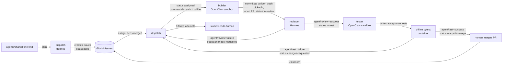

# Agent delivery team

How the Hermes + OpenClaw team takes a ticket from idea to merged code. The roster is
configured in [`agents/team.json`](../agents/team.json); this page explains the design.

## Roster

| Agent | Runtime | Role | Primary model → fallbacks | Tools | GitHub token |
|---|---|---|---|---|---|
| `dispatch` | Hermes profile `dispatch` | Orchestrator: brief → tickets, assigns, re-assigns rejected work | `ollama-cloud/kimi-k3` → `openrouter/nemotron-3-ultra:free` → local `llama3.1:8b` | `todo` only (no shell, files or web) | `dispatch`: issues r/w |
| `builder` | OpenClaw agent `builder` | Implements one ticket per PR, only under `app/` | `ollama-cloud/kimi-k2.7-code` → `openrouter/laguna-s-2.1:free` → local `qwen2.5:7b` | OpenClaw `coding` profile; exec denied; Docker sandbox, no network | `builder`: contents + PRs r/w, **no commit statuses** |
| `reviewer` | Hermes profile `reviewer` | Reads each PR diff against its ticket; approves or sends back | `ollama-cloud/glm-5.3` → `openrouter/gemma-4-31b:free` → local `llama3.1:8b` | `todo` only | `reviewer`: PRs + statuses |
| `tester` | OpenClaw agent `tester` | Writes independent acceptance tests from the ticket; harness runs them offline | `ollama-cloud/gpt-oss:20b` → `openrouter/nemotron-3-super:free` → local `qwen2.5:7b` | same sandbox as builder | `tester`: PRs + statuses |
| human (`Ankita2525`) | — | Reviews and merges | — | — | ruleset approval |

Why this split:

- **Planning on the strongest model, routine work on cheaper ones.** Dispatch makes few,
  high-leverage calls; the builder makes the most calls, so it gets a coding model; the
  tester's job (write tests from criteria) is narrow, so it gets the cheapest model.
- **Runtimes by trust level.** Agents that touch code written by a model (builder, tester)
  run on OpenClaw, inside its Docker sandbox with no network and no exec. Agents that only
  read and judge (dispatch, reviewer) run on Hermes with no tools beyond a todo list.
- **Separate tester from reviewer.** The reviewer reads, the tester runs. A summarizer
  that "looks right" but crashes on import gets caught by the tester even if the reviewer
  misses it.
- **One ticket in flight at a time.** The Ollama Cloud free plan allows one concurrent
  request, so parallel builders would only queue.

## Ticket flow



Every arrow is a GitHub label change plus a comment headed `**[agent · runtime · model]**`,
carrying a hidden `<!-- newsroom-event {...} -->` marker with the attempt number, outcome,
model and token count. The same event goes to `~/newsroom-work/ledger.jsonl`, which feeds
`python3 -m orchestrator report`.

## What blocks bad work

| Gate | Enforced by |
|---|---|
| `main` only changes through PRs with `agent/review` + `agent/test` success and a human approval | GitHub ruleset `main-agent-quality-gates` (verified in `docs/traces/permission-test.md`) |
| Builder cannot mark its own work reviewed/tested | Builder token has no commit-status permission (HTTP 403, verified) |
| Rejected work goes back with the findings | Reviewer/tester set `status:changes-requested`; dispatch's next assignment quotes the findings; builder's `TICKET.md` includes them |
| Retry limit | After `max_attempts` (3) builds, dispatch escalates with `status:needs-human` |
| Builder can only change `app/` | Harness imports only regular files under `app/` from the agent's copy; other writes are reported in the handoff comment and dropped |
| Dispatch can only assign tickets whose dependencies are merged | Harness validates the choice; an invalid choice is logged and re-asked once, never silently replaced |
| Tests run the code, not just read it | Builder tests + tester's acceptance tests run in `newsroom-test-runner` with `--network none`, read-only root, `cap-drop ALL`, no tokens |

## What the harness does and does not do

`orchestrator/` is plumbing written by the human engineer (with AI assistance). It creates
git checkouts, passes each agent's prompt to its runtime, commits the builder's files
**under the builder's identity**, calls the GitHub API **with the acting agent's own token**,
runs tests in the container, and writes the ledger. It never writes product code, never
chooses tickets, and never decides review or test outcomes:

- the ticket list and every assignment come from `dispatch`'s reply;
- every file under `app/` comes from `builder`'s or `tester`'s tool calls;
- every `agent/review` status comes from `reviewer`'s JSON verdict;
- every `agent/test` status is the exit code of pytest on the tester's and builder's tests.

The harness performs commits for the builder because the builder's sandbox has exec
denied and no network (deliberately). Each commit records the agent, runtime, model,
attempt and OpenClaw session id in trailers, so it can be matched to the OpenClaw session log.

## Security notes

- Agents never see a `.git` directory. They work on a plain copy of the tree, so a
  prompt-injected agent cannot plant git hooks or `core.fsmonitor` settings that would run
  on the host when the harness commits. Symlinks and files over 512 KB are not imported.
- GitHub tokens live in `~/.config/newsroom/tokens/<agent>` (mode 600) and are passed only to
  that agent's `gh`/`git` subprocess through the environment, never in argv or logs.
  Agent runtimes and the test container get an environment with all `GH_*`/`GITHUB_*`
  variables removed.
- Model keys live in `~/.config/newsroom/env` and reach Hermes (subprocess environment)
  and the OpenClaw gateway (`scripts/start-gateway.sh`). OpenClaw sandboxes have no network,
  so model calls are made by the gateway, not from inside the sandbox.
- `scripts/setup_agents.py` refuses to run if the OpenClaw profile's verified security
  baseline (sandbox all, network none, read-only root, cap-drop ALL, exec deny, elevated off,
  loopback token-auth gateway) has drifted.

## Running it

```bash
# one-time
python3 scripts/setup_agents.py          # configure Hermes profiles, OpenClaw agents, test image
scripts/start-gateway.sh                 # in its own terminal: gateway with model keys

# drive the board
python3 -m orchestrator plan             # dispatch creates the tickets
python3 -m orchestrator step             # one agent action (assign/build/review/test)
python3 -m orchestrator run --max 10     # loop until idle or waiting for a human merge
python3 -m orchestrator report           # token & model report

# harness tests (no network, no tokens needed)
uv run --with pytest python -m pytest -q orchestrator/tests
```

## Known limitations

- All four agents act through one GitHub machine account (`newsroom-ak-bot`), so GitHub
  shows one user; per-agent identity is in commit author names, trailers, comment headers and
  per-agent tokens (see `docs/agent-identity.md`).
- Reviewer and tester tokens can both write any status context; separation between them
  is by convention in the harness, not enforced by GitHub.
- Local fallback models are weak at tool use and planning. The local Ollama server truncates
  prompts at its default context unless started with `OLLAMA_CONTEXT_LENGTH=65536`; Hermes
  requires a 64K window. Local models are a last resort, not a working tier.
